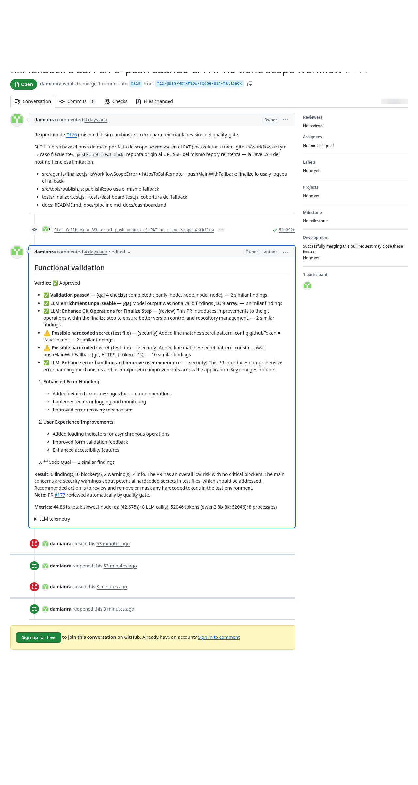

# quality-gate — an autonomous AI code reviewer

> High-level overview for a non-technical audience. For the full technical
> contract see `SPEC.md`.

## The problem

Code review is the bottleneck of every software team: it demands senior
attention, it is repetitive, and it does not scale. Meanwhile, AI code
assistants produce more code than ever — but who reviews *their* pull
requests?

## What it does

`quality-gate` is a self-hosted service that reviews pull requests
automatically. When someone opens a PR on GitHub:

1. A GitHub webhook notifies the service over a secure channel.
2. The PR is cloned into an isolated, temporary workspace.
3. A battery of deterministic checks runs — secret scanning, suspicious
   patterns, dependency audits, language-specific validation.
4. A team of LLM specialists — a **reviewer**, a **security analyst** and
   a **QA engineer** — each reads the change from its own angle, in
   isolated sessions, and reports findings.
5. A final agent synthesizes everything into one verdict and posts it
   back to the PR: a structured comment, a commit status check, and
   optionally a real GitHub approval.

Minutes after a PR is opened, it already carries a consistent,
explainable review — with evidence, severities and the model telemetry
that produced it.

## Why it is interesting (for AI engineering)

- **Multi-agent by design.** Not one giant prompt — separate roles with
  separate contexts, prompts and budgets. Findings are deduplicated and
  severity-scored into a single verdict.
- **Deterministic + LLM hybrid.** The LLM never replaces hard checks —
  scanners find what is provably wrong; models explain, contextualize and
  catch what patterns cannot. A dead model degrades gracefully, never
  fails the run.
- **Prompt-injection aware.** PR content is treated as hostile
  untrusted data: fenced evidence, pattern detection, and findings that
  can only add — never delete or override.
- **Model-agnostic.** Point it at a local Ollama GPU box, OpenAI,
  Anthropic, OpenRouter, or a CLI agent. Each role can use a different
  model — cheap model for summarizing, strong model for security.
- **Production-shaped.** Durable queue that survives restarts, HMAC
  webhook verification, rate limiting, ephemeral workspaces, process
  cleanup, per-call LLM telemetry (tokens, tok/s, VRAM) persisted to
  Postgres.
- **Spec-driven.** The repository is built from a written contract
  (`SPEC.md`): every behavior is a numbered requirement, every commit
  is mapped to one. It is also *dogfooded* — the system reviews its own
  pull requests and has already caught real bugs before merge.

## The value

For a team, it is a tireless first reviewer that never misses a PR and
never hard-blocks merges on a false positive. For anyone exploring AI
engineering, it is a concrete example of how LLM agents get wired into a
real, auditable, self-hosted pipeline — not a demo, but infrastructure
you can run today with `docker compose` (or Podman).

## Stack at a glance

- **Orchestrator**: a LangGraph pipeline (Python) that runs the review
- **Tools server**: deterministic analysis exposed as MCP tools
- **LLM layer**: pluggable providers — Ollama, OpenAI, Anthropic,
  OpenRouter, NVIDIA NIM, custom endpoints, CLI agents
- **Ingress**: FastAPI webhook receiver behind nginx (path allowlist +
  rate-limit); webhook payloads are HMAC-verified before anything runs
- **State**: PostgreSQL (durable queue, checkpoints, run metrics)

Self-hosted and hackable — every PR gets reviewed, possibly by the
system itself.
