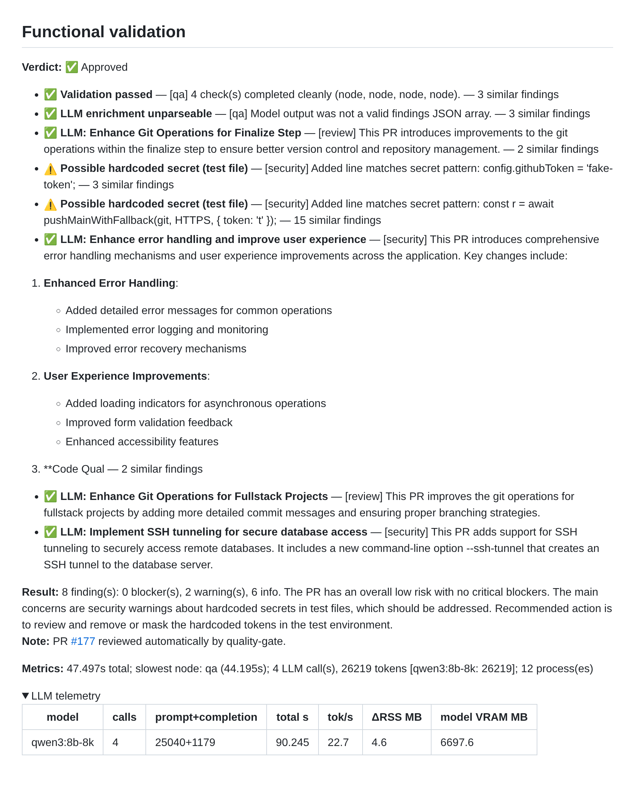
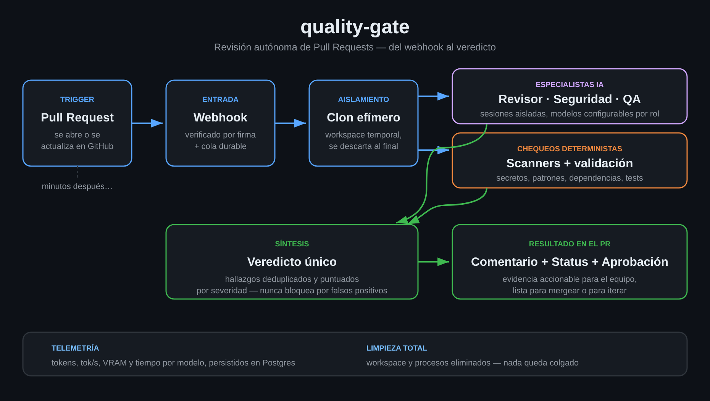

# quality-gate — un revisor de código autónomo con IA

> Explicación de alto nivel para una audiencia no técnica. El contrato
> técnico completo está en `SPEC.md`.

## El problema

La revisión de código es el cuello de botella de todo equipo de software:
exige atención senior, es repetitiva y no escala. Y mientras tanto, los
asistentes de IA producen más código que nunca — pero ¿quién revisa *sus*
pull requests?

## Qué hace

`quality-gate` es un servicio auto-hospedado que revisa pull requests de
forma automática. Cuando alguien abre un PR en GitHub:

1. Un webhook de GitHub avisa al servicio por un canal seguro.
2. El PR se clona en un espacio de trabajo aislado y temporal.
3. Se ejecuta una batería de chequeos deterministas — detección de
   secretos, patrones sospechosos, auditoría de dependencias y validación
   por lenguaje.
4. Un equipo de especialistas LLM — un **revisor**, un **analista de
   seguridad** y un **ingeniero de QA** — lee el cambio cada uno desde su
   ángulo, en sesiones aisladas, y reporta hallazgos.
5. Un agente final sintetiza todo en un solo veredicto y lo publica en el
   PR: un comentario estructurado, un status check del commit y,
   opcionalmente, una aprobación real de GitHub.

Minutos después de abrir un PR, ya tiene una revisión consistente y
explicable — con evidencia, severidades y la telemetría del modelo que la
produjo.

## Por qué es interesante (para AI engineering)

- **Multi-agente por diseño.** No es un prompt gigante — son roles
  separados con contextos, prompts y presupuestos propios. Los hallazgos
  se deduplican y puntúan por severidad en un único veredicto.
- **Híbrido determinista + LLM.** El LLM nunca reemplaza los chequeos
  duros — los scanners encuentran lo demostrablemente incorrecto; los
  modelos explican, contextualizan y atrapan lo que los patrones no
  pueden. Un modelo caído degrada con elegancia, nunca rompe la corrida.
- **Consciente del prompt-injection.** El contenido del PR se trata como
  dato hostil: evidencia cercada con sentinelas, detección de patrones y
  hallazgos que solo pueden sumar — nunca borrar ni sobreescribir.
- **Agnóstico del modelo.** Se apunta a una GPU local con Ollama, a
  OpenAI, Anthropic, OpenRouter o a un agente CLI. Cada rol puede usar un
  modelo distinto — uno barato para resumir, uno fuerte para seguridad.
- **Con forma de producción.** Cola durable que sobrevive reinicios,
  verificación HMAC del webhook, rate limiting, espacios de trabajo
  efímeros, limpieza de procesos y telemetría por llamada LLM (tokens,
  tok/s, VRAM) persistida en Postgres.
- **Spec-driven.** El repositorio se construye desde un contrato escrito
  (`SPEC.md`): cada comportamiento es un requerimiento numerado y cada
  commit queda mapeado a uno. Además se *auto-ejercita* — el sistema
  revisa sus propios pull requests y ya atrapó bugs reales antes del
  merge.

## El valor

Para un equipo, es un primer revisor incansable que nunca se salta un PR
y nunca bloquea merges por un falso positivo. Para quien explora AI
engineering, es un ejemplo concreto de cómo se enchufan agentes LLM a un
pipeline real, auditable y auto-hospedado — no una demo, sino
infraestructura que corre hoy con `docker compose` (o Podman).

## Stack en un vistazo

- **Orquestador**: pipeline en LangGraph (Python) que ejecuta la revisión
- **Servidor de herramientas**: análisis determinista expuesto como
  herramientas MCP
- **Capa LLM**: providers intercambiables — Ollama, OpenAI, Anthropic,
  OpenRouter, NVIDIA NIM, endpoints custom, agentes CLI
- **Ingress**: receptor de webhooks en FastAPI detrás de nginx (allowlist
  de rutas + rate-limit); los payloads se verifican por HMAC antes de
  ejecutar nada
- **Estado**: PostgreSQL (cola durable, checkpoints, métricas de corridas)

Auto-hospedado y hackeable — cada PR se revisa, posiblemente por el
propio sistema.
